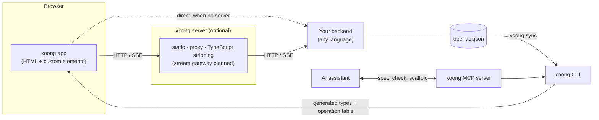
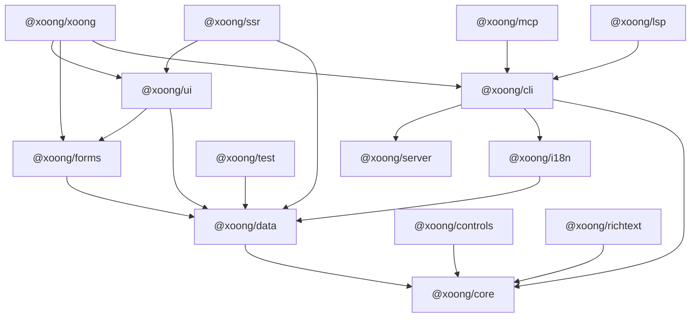
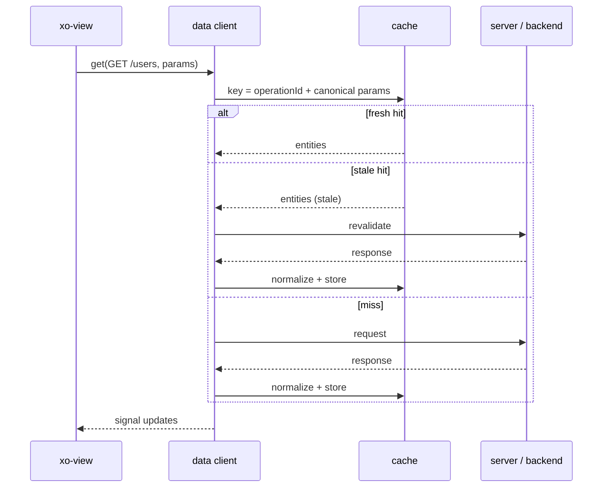
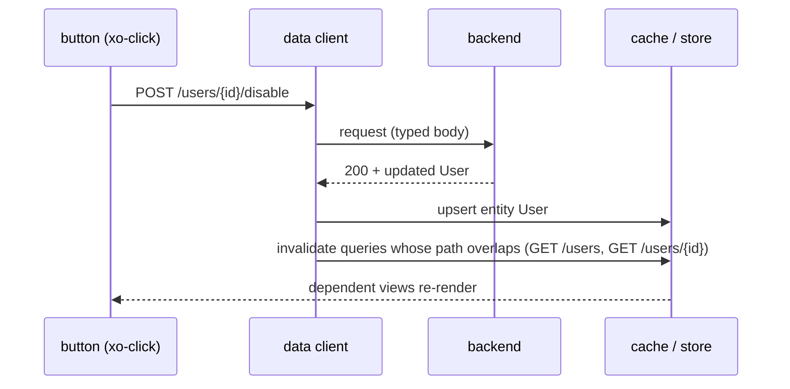
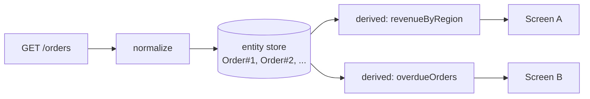
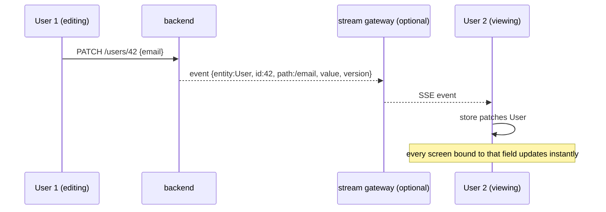

# Architecture

Status: **Draft**. Diagrams are Mermaid (rendered by GitHub and most editors).
A single-picture version is in [architecture.html](architecture.html).

## 1. System context

xoong sits between the browser and *your* backend. It does not replace the
backend and contains no business logic.



## 2. Layers

| Layer | Package | Runs in | Responsibility |
|---|---|---|---|
| Reactivity & elements | `@xoong/core` | Browser (+ Node for prerendering) | Signals, `XoElement` base, `html` templates, `XoControl` (form-associated base). No dependencies |
| Data | `@xoong/data` | Browser | Typed client from OpenAPI, cache, mutations, entity store, derived views, `<xo-view>` and its call syntax, stream subscriber, error normalization |
| Forms | `@xoong/forms` | Browser | Draft model with per-path state, validation from the OpenAPI request schema, custom rules, payload normalization, dirty tracking |
| UI | `@xoong/ui` | Browser | `xoong.css` tokens, `xo-table`, schema-driven `xo-form`, `xo-dialog`, toast, confirm, `<xo-router>` |
| Controls | `@xoong/controls` | Browser | Tabs, popover, tooltip, menu, combobox, chips, tag input, carousel |
| Rich text | `@xoong/richtext` | Browser | A small `contenteditable` editor with sanitized HTML in and out, for forms |
| i18n | `@xoong/i18n` | Browser (+ CLI for extraction) | ICU-subset JSON catalogs, `xo-t` in markup, locale signal, `Intl` formats |
| Tooling | `@xoong/cli` | Node (dev only) | `new`, `dev`, `build`, `sync`, `check`, `doctor`, `render`, `i18n extract|check` |
| Server | `@xoong/server` | Any Fetch-API runtime | Static files, API proxy, TypeScript type stripping, Node adapter. The stream gateway is planned |
| Prerendering | `@xoong/ssr` | Node | Runs the real `<xo-view>` runtime in happy-dom and writes HTML (used by `xoong render`) |
| Testing | `@xoong/test` | Vitest | Mount screens, mock the API from `operations.json`, push live events |
| AI | `@xoong/mcp` | Node (dev only) | MCP server over stdio: spec and docs, operations, `xoong check`, explanations of error codes, elements and attributes |
| Editors | `@xoong/lsp` | Node (dev only) | Language server: the `xoong check` diagnostics, completion, hover |
| Umbrella | `@xoong/xoong` | Browser + Node | One install: re-exports core and data, adds `/ui` and `/view` subpaths (ui, forms through it) and the `xoong` command from cli |

### Dependency rule

Arrows mean "depends on" (checked against each package's `package.json`).
Nothing may import against the arrow.



The umbrella also depends on `core` and `data`, and every package above that
reaches `core` depends on it directly too; those arrows are left out of the
picture. `server` has no xoong dependency. `ssr` is loaded by `xoong render`
when it is installed, not required by `cli`.

* `core`, `data`, `forms`, `ui`, `controls`, `richtext`, `i18n` are the
  **runtime**: ESM only, no build step required, no dependency besides other
  xoong runtime packages.
* `cli`, `server`, `mcp`, `lsp`, `ssr`, `test` are **tooling**: they may have
  dependencies (`parse5`, `yaml`, `amaro`, `happy-dom`), but never ship to the
  browser.
* `server` uses only web-standard `Request`/`Response`, so it is not tied to a
  Node version.

## 3. Repository layout

```
xoong/
├─ packages/
│  ├─ core/      # signals, element base, XoControl, html templates
│  ├─ data/      # openapi client, cache, store, derived, stream, <xo-view>
│  ├─ forms/     # draft model, validation, payload normalization
│  ├─ ui/        # xoong.css, xo-table, xo-form, xo-dialog, toast, router
│  ├─ controls/  # tabs, popover, tooltip, menu, combobox, chips, carousel
│  ├─ richtext/  # small contenteditable editor
│  ├─ i18n/      # catalogs, xo-t, locale signal
│  ├─ cli/       # xoong new|dev|build|sync|check|doctor|render|i18n
│  ├─ server/    # fetch-handler: static, proxy, TypeScript stripping
│  ├─ ssr/       # prerendering in Node
│  ├─ test/      # Vitest helpers
│  ├─ mcp/       # MCP server for AI assistants
│  ├─ lsp/       # language server
│  └─ xoong/     # umbrella package (@xoong/xoong)
├─ examples/     # small-site, admin, large-site (each doubles as a benchmark)
├─ docs/
├─ llms.txt      # the public API in a few thousand tokens
└─ LICENSE
```

## 4. A screen at runtime

1. HTML arrives (static file, or SSR output).
2. The browser upgrades `<xo-view>`, `<xo-table>`, ... in place. There is **no
   hydration step**: the server HTML *is* the component's DOM.
3. Each tag's module is loaded on demand (only tags present on the page are
   fetched).
4. `<xo-view get="/users">` asks `@xoong/data` for operation `GET /users`.
5. Data arrives, lands in the entity store, and signals update exactly the DOM
   nodes bound to them (fine-grained, no tree re-render).

## 5. Flow: read with automatic cache



The developer never declares a cache key. See [data-layer.md](data-layer.md).

## 6. Flow: mutation with automatic invalidation



## 7. Flow: shared data, many screens



One fetch, one copy of each entity, any number of computed views. No second
API, no second request.

## 8. Flow: live updates (streaming)



Streaming is opt-in per screen (`live`) and needs `streamUrl` in `configure()`.
The backend may emit events itself if it follows the event format in
[data-layer.md](data-layer.md#6-streaming); the gateway (planned) is for
backends that cannot.

## 9. Cross-cutting concerns

| Concern | Decision |
|---|---|
| Styling | Light DOM + plain CSS/SCSS; tokens as custom properties; `@layer` for ordering; `@scope` for locality. See [styling.md](styling.md) |
| Accessibility | Native elements first (`<dialog>`, `<details>`, Popover); `xoong check` lints common a11y issues |
| Errors | Normalized from OpenAPI error schemas (RFC 9457 `problem+json` recommended); one global handler plus per-view override |
| Auth | Token injection and refresh live in the proxy/data client config, not in screens |
| i18n | `@xoong/i18n`: JSON catalogs, `xo-t` in markup, locale signal. See [ADR-0010](decisions/0010-internationalization.md) |
| Routing | `<xo-router>` in `@xoong/ui` (History API); one declaration per route |
| SSR | `@xoong/ssr` prerenders the same Light DOM markup (`xoong render`); no hydration. Public pages first; no request-time SSR |
| Observability | Planned: a debug mode that explains every cache hit, invalidation and patch |

## 10. Known risks

1. **Entity identity.** Normalization needs a stable id. Weak OpenAPI documents
   cause ambiguity; `xoong doctor` reports and suggests fixes.
2. **Streaming contract.** Ordering, reconnect and conflicts need a versioned
   event format and resync strategy.
3. **Platform support.** Newer APIs (anchor positioning, customizable select)
   vary across browsers; each one needs a documented fallback or an explicit
   support statement.
4. **Ecosystem.** There is no third-party component market. The built-in admin
   set must be good enough that one is not needed.
