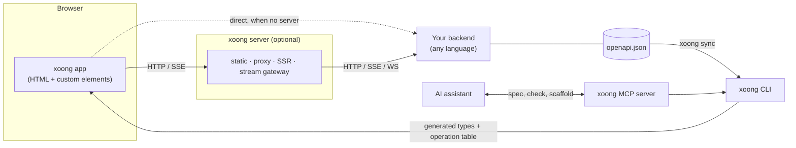
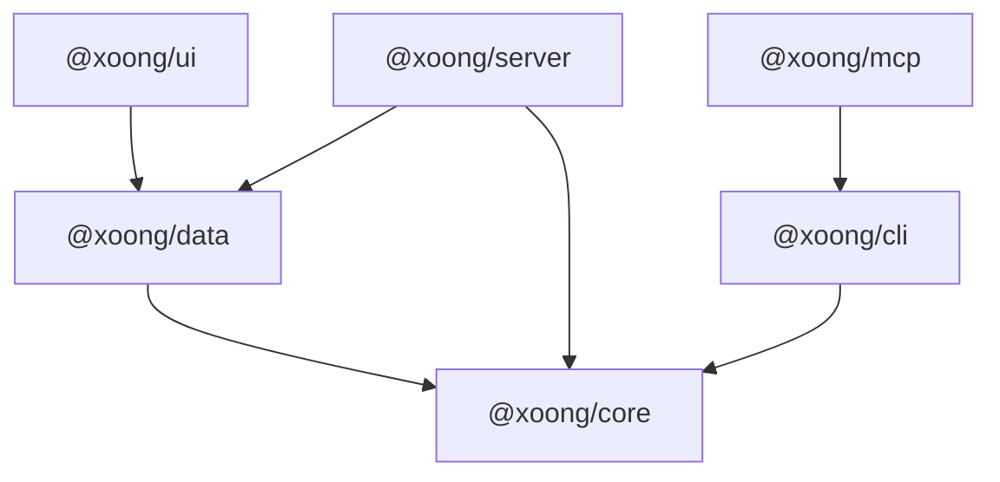
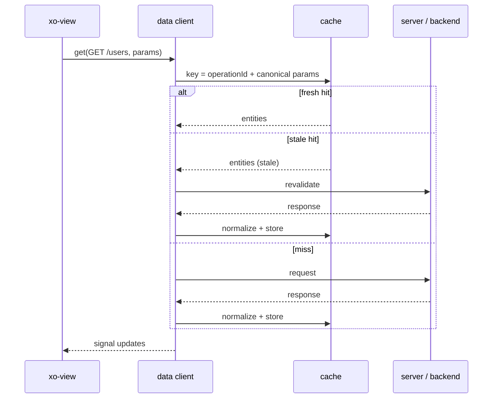
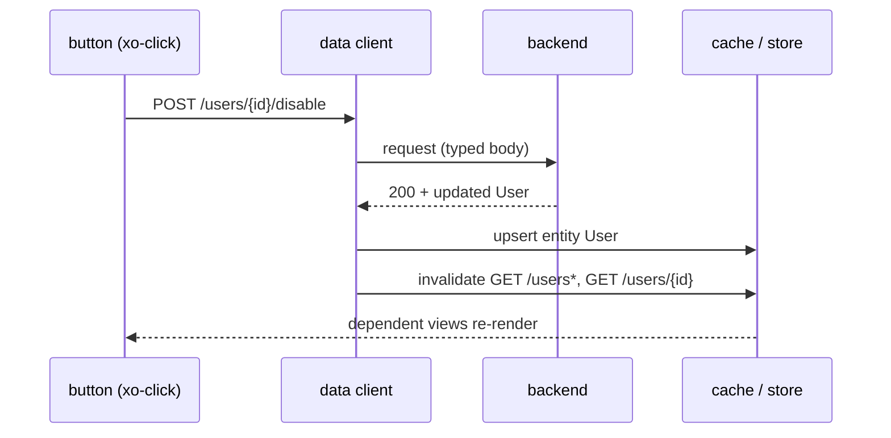
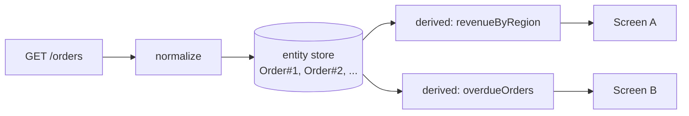
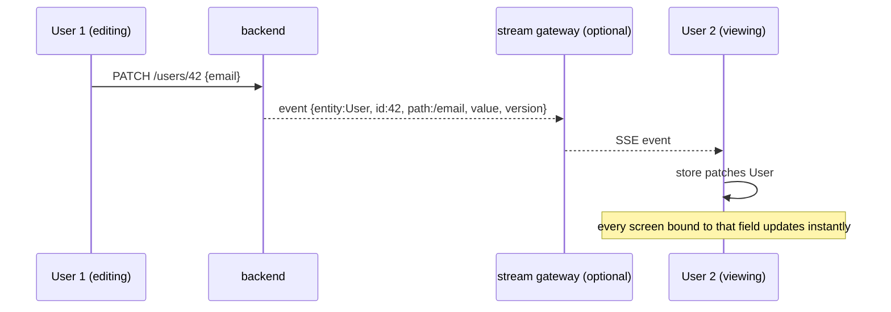

# Architecture

Status: **Draft**. Diagrams are Mermaid (rendered by GitHub and most editors).
A single-picture version is in [architecture.html](architecture.html).

## 1. System context

xoong sits between the browser and *your* backend. It does not replace the
backend and contains no business logic.



## 2. Layers

| Layer | Package | Runs in | Responsibility |
|---|---|---|---|
| Reactivity & elements | `@xoong/core` | Browser (+ server for SSR) | Signals, base element, declarative attributes, template, router |
| Data | `@xoong/data` | Browser | Typed client from OpenAPI, cache, mutations, entity store, derived views, stream subscriber, error normalization |
| UI | `@xoong/ui` | Browser | `xoong.css` tokens, `xo-table`, `xo-form`, `xo-dialog`, admin layout |
| Tooling | `@xoong/cli` | Node/Deno/Bun (dev only) | `new`, `dev`, `build`, `sync`, `check`, `doctor`, `codemod` |
| Server | `@xoong/server` | Any Fetch-API runtime | Static files, API proxy, SSR, stream gateway |
| AI | `@xoong/mcp` | Node (dev only) | MCP tools backed by the CLI and docs |

### Dependency rule

Arrows mean "may import". Nothing may import against the arrow.



* `core`, `data`, `ui` are the **runtime**: zero dependencies, ESM only, no
  build step required.
* `cli`, `server`, `mcp` are **tooling**: they may have dependencies, but never
  ship to the browser.
* `server` uses only web-standard `Request`/`Response`, so it is not tied to a
  Node version.

## 3. Planned repository layout

```
xoong/
├─ packages/
│  ├─ core/      # signals, element base, directives, router
│  ├─ data/      # openapi client, cache, store, derived, stream
│  ├─ ui/        # xoong.css, xo-table, xo-form, xo-dialog, admin layout
│  ├─ cli/       # xoong new|dev|build|sync|check|doctor|codemod
│  ├─ server/    # fetch-handler: static, proxy, ssr, stream gateway
│  └─ mcp/       # MCP server for AI assistants
├─ examples/     # small-site, admin, large-site (each doubles as a benchmark)
├─ docs/
├─ llms.txt      # whole public API in < 3k tokens
└─ LICENSE
```

## 4. A screen at runtime

1. HTML arrives (static file, or SSR output).
2. The browser upgrades `<xo-view>`, `<xo-table>`, ... in place. There is **no
   hydration step**: the server HTML *is* the component's DOM.
3. Each tag's module is loaded on demand (only tags present on the page are
   fetched).
4. `<xo-view get="/users">` asks `@xoong/data` for operation `GET /users`.
5. Data arrives, lands in the entity store, and signals update exactly the DOM
   nodes bound to them (fine-grained, no tree re-render).

## 5. Flow: read with automatic cache



The developer never declares a cache key. See [data-layer.md](data-layer.md).

## 6. Flow: mutation with automatic invalidation



## 7. Flow: shared data, many screens



One fetch, one copy of each entity, any number of computed views. No second
API, no second request.

## 8. Flow: live updates (streaming)



Streaming is opt-in per screen. The backend may emit events itself if it
follows the event format in [data-layer.md](data-layer.md#streaming); the
gateway exists for backends that cannot.

## 9. Cross-cutting concerns

| Concern | Decision |
|---|---|
| Styling | Light DOM + plain CSS/SCSS; tokens as custom properties; `@layer` for ordering; `@scope` for locality. See [styling.md](styling.md) |
| Accessibility | Native elements first (`<dialog>`, `<details>`, Popover); `xoong check` lints common a11y issues |
| Errors | Normalized from OpenAPI error schemas (RFC 9457 `problem+json` recommended); one global handler plus per-view override |
| Auth | Token injection and refresh live in the proxy/data client config, not in screens |
| i18n | Out of scope for 0.x; text lives in the HTML. Revisit after 0.5 |
| Routing | History-API router in `core`; one declaration per route |
| SSR | Server renders the same Light DOM markup; no hydration. Public pages first (post-0.6) |
| Observability | `xoong debug` mode explains every cache hit, invalidation and patch |

## 10. Known risks

1. **Entity identity.** Normalization needs a stable id. Weak OpenAPI documents
   cause ambiguity; `xoong doctor` reports and suggests fixes.
2. **Streaming contract.** Ordering, reconnect and conflicts need a versioned
   event format and resync strategy.
3. **Platform support.** Newer APIs (anchor positioning, customizable select)
   vary across browsers; each one needs a documented fallback or an explicit
   support statement.
4. **Ecosystem.** There is no third-party component market. The built-in admin
   set must be good enough that one is not needed.
