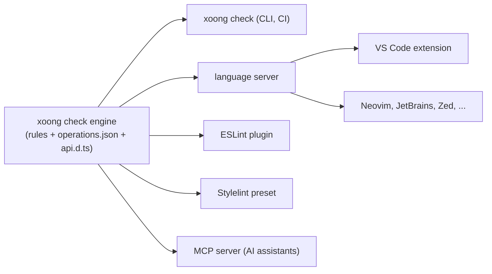

# Editor and lint integrations

Status: milestone 0.6.x. **HTML custom data (1) and a first language server (2) are done**; the VS Code extension, lint presets and
SARIF output are planned.

Goal: the mistakes `xoong check` reports should appear **while typing**, with the same message
and the same fix, in any editor and in CI. One rule engine, several front ends.

## Principle: one engine



Rules are written once. A new rule must appear in every front end without extra work, and its
message must say how to fix the problem (see [ai-integration.md](ai-integration.md)).

## 1. Cheapest first: HTML custom data (no extension needed) — done

`xoong sync` writes `.xoong/xoong.html-data.json` next to `operations.json` (the format VS Code's
`html.customData` setting reads). Point the editor at it once:

```json
{ "html.customData": ["./.xoong/xoong.html-data.json"] }
```

It gives completion and hover docs for every `xo-*` element and attribute, offers the real operation names for
`xo-click`, `xo-submit`, `<xo-view get>` and `<xo-form op>` (mutations only for `xo-click` and `xo-submit`, reads for
`get`), `p-<name>` attributes for the path parameters in your API, and the values of the attributes that take a fixed set
(`xo-confirm-kind`, `<xo-dialog size>`, the sizes and statuses of the controls). Every attribute an element reads is listed with its
description (a test compares the lists with what the elements read), and the form controls list `required`, `disabled` and `readonly`.
It is regenerated on every sync, and tests keep it in step with the syntax lists. Similar formats exist for other editors; add them as needed.

## 2. Language server (the real integration) — first version done

`@xoong/lsp` (`xoong-lsp`, LSP over stdio) is implemented with: **diagnostics** (the exact findings of `xoong check`, same code,
message and fix, for HTML and for JS/TS files, so every new rule shows up in the editor without extra work), **completion** of operation names inside `xo-click`, `xo-submit`, `get` and `op`
(mutations for the first three, reads written as paths for `get`), of `xo-*` attribute and element names, of **the attributes of the
element you are in** (`page-size` and `page-sizes` inside `<xo-pager `, `p-<param>` inside `<xo-view `), of **the values** of attributes that take a fixed
set (`xo-confirm-kind="`, `<xo-dialog size="`) and of the ids of the `<xo-dialog>`s of the file inside `xo-open="`; **hover** docs for elements, `xo-*` attributes, the
attributes of an element and their values; and **quick fixes** that replace an unknown operation, a misspelled `xo-*` attribute or element,
or a value outside its set with the closest one. The server reports the version of its package. One malformed message never ends the session (requests get an error reply), and messages are handled in order. It finds `.xoong/operations.json` from the workspace folder
upward and re-reads it when it changes (saving a file re-checks it). Not done: scope-aware completion of `{field}` paths, hover for
operation types, go to definition. Any editor that can launch a language server for HTML/JS/TS files can use it, for example
Neovim (`vim.lsp.start({ cmd = { 'node', 'packages/lsp/src/cli.js' }, ... })`). A test in `test/architecture.test.mjs` fails when an element or
an attribute is added to `syntax.js` and the language server cannot complete or explain it.

The original design follows.

Reads `.xoong/operations.json` and `.xoong/api.d.ts`, and offers:

| Feature | Example |
|---|---|
| Completion | `xo-click="` lists operations (`POST /users/{id}/disable`); `{` lists fields of the current scope |
| Diagnostics | Unknown operation (with the closest match), missing path param, unknown `{path}`, wrong body field |
| Hover | Shows the operation's params, body and response type; shows entity shape for `{name}` |
| Go to definition | From an operation to the OpenAPI document; from a tag to its element class |
| Quick fix | "Replace with `POST /users/{id}/disable`", "Add `p-id`" |
| Refresh | Re-reads the generated files when `xoong sync` runs |

Scope tracking (`xo-each`, nested views, `p-*` params) is the hard part: the server must model the
same scope rules as the runtime. These rules are shared code, not re-implemented.

## 3. VS Code extension

A thin wrapper around the language server plus:

* commands: `xoong: Sync OpenAPI`, `xoong: Run Doctor`, `xoong: Open Operations`;
* a status bar item showing the synced spec and the number of findings;
* a tree view of operations and entities;
* snippets for a list screen, a form screen and a live screen.

## 4. Lint presets

| Tool | What it checks |
|---|---|
| **ESLint plugin** (`eslint-plugin-xoong`) | `effect()` that fetches data (use a view), writes to a signal it reads, missing disposal, calls to the data client with unknown operations (typed via `api.d.ts`), `derived()` that triggers requests |
| **Stylelint config** | Styles belong to a layer (`@layer app`), token usage instead of raw colors where tokens exist, no bare element selectors outside `@scope`, no `!important` against xoong layers |
| **HTML validation** | `xo-*` attribute syntax, accessible names on buttons and form fields, `aria-busy` misuse |

All three ship as shareable configs with a `recommended` preset, so adopting them is one line.

## 5. CI

`xoong check --format sarif` so findings show up in GitHub code scanning and similar systems;
non-zero exit on errors; `--max-warnings` for gradual adoption.

## Order of work

1. HTML custom data (days, high value).
2. Extract the rule engine from `xoong check` so it is callable as a library.
3. Language server with diagnostics and completion for operations.
4. VS Code extension and the ESLint/Stylelint presets.
5. Hover, quick fixes and other editors.

Depends on `xoong check` (0.6). Until then the only editor help is the generated `api.d.ts` and
the JSDoc in the runtime packages.
