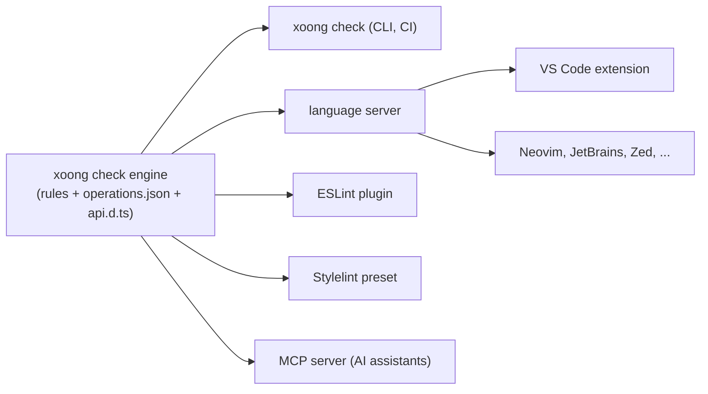

# Editor and lint integrations

Status: **Planned** (milestone 0.6.x). Nothing here is implemented yet.

Goal: the mistakes `xoong check` reports should appear **while typing**, with the same message
and the same fix, in any editor and in CI. One rule engine, several front ends.

## Principle: one engine

Rules are written once. A new rule must appear in every front end without extra work, and its
message must say how to fix the problem (see [ai-integration.md](ai-integration.md)).

## 1. Cheapest first: HTML custom data (no extension needed)

Ship `xoong.html-data.json` (the format VS Code's `html.customData` setting reads). It gives
completion and hover docs for `<xo-view>`, `<xo-table>`, `xo-each`, `xo-if`, `xo-click`,
`xo-submit`, `p-*` and the bubbling events. Works in VS Code today, and similar formats exist for
other editors.

## 2. Language server (the real integration)

Reads `.xoong/operations.json` and `.xoong/api.d.ts`, and offers:

| Feature | Example |
|---|---|
| Completion | `xo-click="` lists operations (`POST /users/{id}/disable`); `{` lists fields of the current scope |
| Diagnostics | Unknown operation (with the closest match), missing path param, unknown `{path}`, wrong body field |
| Hover | Shows the operation's params, body and response type; shows entity shape for `{name}` |
| Go to definition | From an operation to the OpenAPI document; from a tag to its element class |
| Quick fix | "Replace with `POST /users/{id}/disable`", "Add `p-id`" |
| Refresh | Re-reads the generated files when `xoong sync` runs |

Scope tracking (`xo-each`, nested views, `p-*` params) is the hard part: the server must model the
same scope rules as the runtime. These rules are shared code, not re-implemented.

## 3. VS Code extension

A thin wrapper around the language server plus:

* commands: `xoong: Sync OpenAPI`, `xoong: Run Doctor`, `xoong: Open Operations`;
* a status bar item showing the synced spec and the number of findings;
* a tree view of operations and entities;
* snippets for a list screen, a form screen and a live screen.

## 4. Lint presets

| Tool | What it checks |
|---|---|
| **ESLint plugin** (`eslint-plugin-xoong`) | `effect()` that fetches data (use a view), writes to a signal it reads, missing disposal, calls to the data client with unknown operations (typed via `api.d.ts`), `derived()` that triggers requests |
| **Stylelint config** | Styles belong to a layer (`@layer app`), token usage instead of raw colors where tokens exist, no bare element selectors outside `@scope`, no `!important` against xoong layers |
| **HTML validation** | `xo-*` attribute syntax, accessible names on buttons and form fields, `aria-busy` misuse |

All three ship as shareable configs with a `recommended` preset, so adopting them is one line.

## 5. CI

`xoong check --format sarif` so findings show up in GitHub code scanning and similar systems;
non-zero exit on errors; `--max-warnings` for gradual adoption.

## Order of work

1. HTML custom data (days, high value).
2. Extract the rule engine from `xoong check` so it is callable as a library.
3. Language server with diagnostics and completion for operations.
4. VS Code extension and the ESLint/Stylelint presets.
5. Hover, quick fixes and other editors.

Depends on `xoong check` (0.6). Until then the only editor help is the generated `api.d.ts` and
the JSDoc in the runtime packages.
