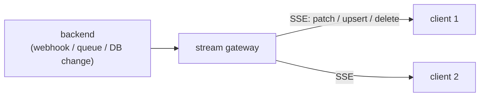

# Server (optional)

Status: **static, proxy, TypeScript stripping, import map and `xoong dev` are implemented** (tested,
including a real-browser end-to-end test). **Prerendering (`@xoong/ssr`) is done in a first version; the stream gateway is planned.** Package: `@xoong/server`.

A xoong app can run with **no server at all** (static files, direct calls to
your backend). The server package adds four opt-in capabilities.

## Design constraints

* One handler with the web-standard signature `(Request) => Response`.
  It runs on Node, Deno, Bun, Cloudflare Workers, or behind Express/Nginx.
  No dependency on a specific Node version.
* No API routes and no business logic. The backend stays yours.
* Each capability is enabled separately.

```js
// Portable core: no Node imports. File access is injected.
import { createHandler } from '@xoong/server'

const handler = createHandler({
  files: async (path) => /* { body, type? } | null */ null,   // where files come from
  proxy: { '/api': 'https://backend.internal' },              // prefix -> upstream origin
  packages: { '@xoong/core': { prefix: '/@xoong/core', exports: { '.': './src/index.js' } } }, // import map
  transform: { '.ts': (code, path) => stripTypes(code) },     // by extension
})
```

On Node, `@xoong/server/node` provides the adapters (`nodeFiles(root)`, `stripTypes`, `createDevHandler`,
`serve(handler, { port })`). `xoong dev` wires them together and reads `xoong.config.json`:

```json
{ "port": 5173, "proxy": { "/api": "http://localhost:8080" }, "spa": false }
```

## 1. Static and dev

`xoong dev` serves the project folder, the installed `@xoong/*` packages (with an import map injected
into HTML pages that have none) and strips TypeScript types from `.ts` files on request (erasable syntax
only; the transform keeps line and column positions). Import local TypeScript with the `.ts` extension.
Not done yet: live reload and SCSS compilation.

`--base /admin` (or `"base": "/admin"` in `xoong.config.json`) is the same prefix as `xoong build --base`. The injected import map, root-absolute `script`/`link` URLs, root-absolute CSS `url()` and `@import`, and root-absolute import specifiers are prefixed with it. A request whose path still starts with the prefix is served from the project root, so it works both when the dev server is opened at `/admin/...` and when a reverse proxy has already stripped the prefix. `X-Forwarded-Prefix` overrides `--base` for that request when the header is a safe path (`/admin`, not a scheme, `..` or `//`). `<a href>` is not rewritten.

`allowedHosts` accepts a host name, or `"*"` to turn the host check off (a LAN preview whose `Host` is not the bind address). `X-Forwarded-Host` is not trusted in place of `Host`. `"*"` also removes the protection against DNS rebinding, so use it only on a trusted network, never on a machine that holds anything private. `X-Forwarded-Prefix` is honoured when it is a safe path; run the dev server behind a proxy you trust, because any client that can reach it can set the header.

**Your own packages.** A package that ships browser code (a component library, a theme) is named in `xoong.config.json`:
`{ "packages": ["rainlet"] }`. `xoong dev` and `xoong build` then serve it under `/@rainlet/...` (scoped names keep their scope: `/@acme/ui/...`)
and resolve `import 'rainlet'` and `import 'rainlet/widgets/slug'` through its `exports` map the way Node does: conditions (`browser`, `import`, `default`),
subpaths such as `"./theme.css"` (usable as `<link href="/@rainlet/theme.css">`), and wildcards (`"./widgets/*": "./src/widgets/*.js"`, so import `rainlet/widgets/slug`
without the extension). Entries under `./server` are Node-only and never served. The package must be installed (`node_modules`) and import only relative files or xoong packages.

## 2. Proxy

* Removes CORS pain in development and production.
* Matches whole path segments (`/api` does not match `/apix`), longest prefix first; redirects are not followed.
* Streams bodies both ways, so server-sent events pass through unbuffered, and closing the browser tab
  stops the upstream read.
* Drops hop-by-hop headers and adds `x-forwarded-host/proto`; an unreachable upstream answers 502 with the reason.
* Planned: credential injection and refresh, retry and timeout policy.

## 3. SSR: prerendering (first version done)

`@xoong/ssr` renders a page with its data by running **the same `<xo-view>` runtime** on a DOM from happy-dom, so the syntax has
one implementation. Because the output is Light DOM, there is **no hydration step** and no mismatch class of bugs: every
top-level `<xo-view>` keeps its original markup in a `<template data-xo-template>`, and when the browser starts the view it
renders again from that template. The prerendered rows are only the first paint (and what crawlers and no-JavaScript visitors see).

```bash
xoong render index.html --api http://localhost:8080 --out dist/index.html     # needs @xoong/ssr
```

```js
import { renderPage } from '@xoong/ssr';
const html = await renderPage(pageHtml, { operations, baseUrl: 'http://backend', headers: () => ({}) });
```

* **Routers and SEO:** `--url` / `url` renders the route of that URL when the page has an `<xo-router>`; see docs/admin.md ("SEO and prerendering").
* Scope: public, cacheable pages. Personalised pages stay client-rendered until a later ADR (the server would need the
  visitor's credentials; use `headers` only for service credentials).
* The first render installs `window`, `document` and friends on `globalThis` for the rest of the process: prerender in a build
  script or a dedicated process, not inside a server that runs code that detects a browser by `typeof window`.
* A page whose API calls fail still renders (its `$error` branches show). Pass `failOnError: true` to make that an error (it carries
  `.errors`), or `onError` to observe the failures and answer 404/502 yourself.
* Pages render one after another (DOM globals are process-wide). A page whose data does not load within `timeoutMs`
  (default 10 s) fails with a clear error instead of rendering half.
* Scripts and stylesheets of the page are neither run nor fetched during rendering.
* Not done: a request-time middleware in `xoong dev` / `@xoong/server`, caching and revalidation policy, per-route
  rendering of `p-*` params from the URL, rendering `live` views' first stream state.
* Verified in real Chromium: the prerendered admin page shows its rows with JavaScript disabled, and with JavaScript the view takes
  over without duplicated rows, with working actions and no errors.

## 4. Stream gateway

For backends that cannot emit xoong stream events:



The gateway authenticates clients, filters events by what each client may see,
assigns `version`s and supports `Last-Event-ID` replay. It targets small and
medium deployments; very large fan-out needs dedicated infrastructure.

## Operating it

* Treat the proxy and gateway as security-sensitive: they hold credentials and
  decide visibility.
* All server behaviour is described by one small config file validated by
  `xoong check`.
